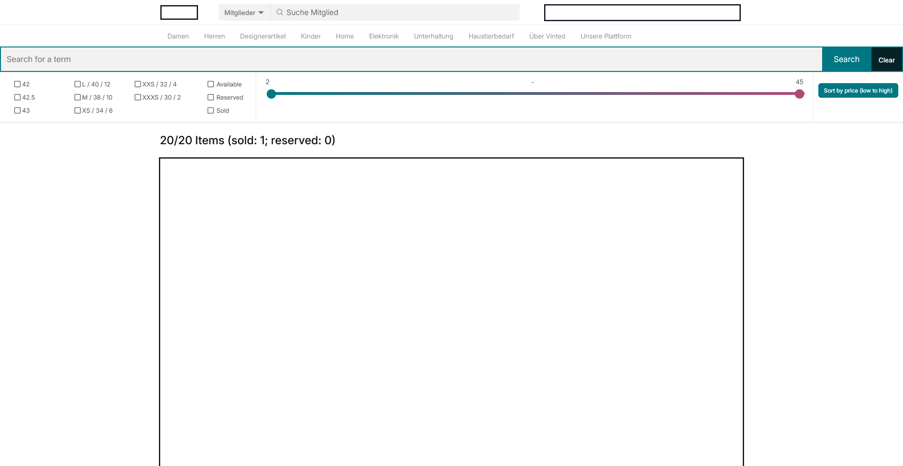

# favorites_filter

You can easily filter your favorites on Vinted by size, availability and search term and sort by price with this browser addon.

## Disclaimer: 
This is an unofficial add-on and is not affiliated with, endorsed by, or sponsored by Vinted. It filters and sorts items already loaded in your browser. Vinted’s terms may restrict the use of third-party tools, and using this add-on may result in account restrictions. Compatibility and continued functionality are not guaranteed.

## Requirements

- Firefox or Chrome

Both browsers share the same JavaScript and styles. The build creates a separate
manifest for each browser: Chrome uses a background service worker, Firefox uses
a background script that is non-persistent by default in Manifest V3. The Firefox
manifest omits the unsupported `persistent` property.

## Features

- Filter by size
- Filter by availability
- Filter by search term
- Filter by price
- Sort by price

## Install

**Firefox:** [Add it to Firefox](https://addons.mozilla.org/de/firefox/addon/filter-favorites/)

**Chrome:** not on the Chrome Web Store due to the registration fee. Download `favorites_filter-chrome.zip` from the [releases](https://github.com/tobiasfrck/favorites_filter/releases), unpack it, then load the folder via `chrome://extensions` with developer mode enabled.

## Build and development

Run `npm run build` with Node.js 22 or newer. The build needs no npm dependencies
and creates two directories containing only the extension's runtime files:

- `dist/chrome`: load this directory via `chrome://extensions`. The project root
  also remains directly loadable in Chrome.
- `dist/firefox`: open `about:debugging#/runtime/this-firefox`, choose
  **Load Temporary Add-on**, then select this directory's `manifest.json`.

The root `manifest.json` is the common base and the Chrome manifest.
`manifests/firefox.json` overrides only the background configuration and adds the
existing Firefox add-on ID. Edit the shared source files, then rebuild; do not
edit the generated copies in `dist`.

The release workflow builds and validates both packages. `favorites_filter-chrome.zip` is
the Chrome download; `favorites_filter-firefox.zip` is the Firefox package for AMO
submission. Regular Firefox installations continue to use the signed AMO version.

## Screenshots

## Tests

Run `npm install`, then `npx playwright install chromium firefox` and `npm test`.
The browser tests simulate page rerenders, delayed loading, navigation and slider
interaction locally; no Vinted account is needed.

`npm run test:build` checks the generated manifests, packaged files and toolbar
message handling for both browser APIs. It needs no npm dependencies.

Set `TEST_BROWSER=firefox` to run the same tests in Firefox. `TEST_BROWSER_PATH`
can point to an existing browser executable (a Playwright build is required for Firefox).

## Code-Disclaimer
The code quality may not be the best as I this is my first browser addon and I just wanted to try some stuff.
